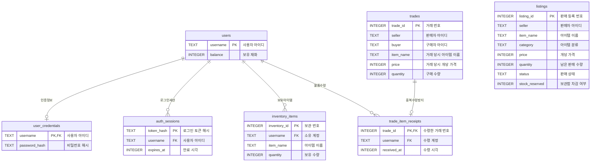
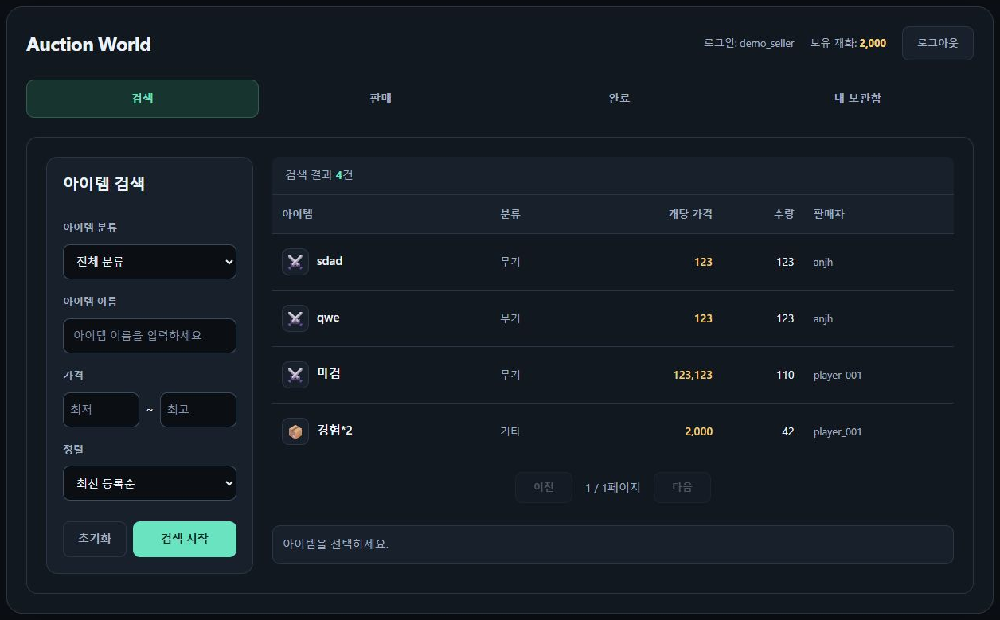
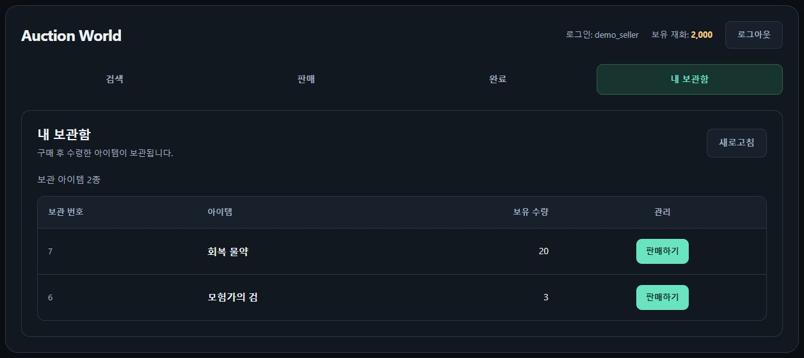

# Auction World

FastAPI와 SQLite로 구현한 게임 아이템 거래소 개인 프로젝트입니다.
실제 게임 계정이나 재화와 연결되지 않는 가상 거래 서비스입니다.

## 주요 기능

- 회원가입, 비밀번호 해시 저장, 로그인 및 로그아웃
- 아이템 이름·분류·가격 범위 검색과 가격순 정렬
- 보유 아이템의 판매 등록 및 수량 차감
- 구매 시 재화 이동, 판매 수량 감소, 거래 기록 생성
- 구매 물품 수령 및 중복 수령 방지
- 판매 취소 시 남은 수량을 보관함에 반환
- 로그인한 계정의 구매·판매 내역과 보관함 조회

## 사용 기술

|     영역      |                기술                |
|--------------|------------------------------------|
| API           | Python, FastAPI                   |
| 데이터 저장    | SQLite                            |
| 화면          | HTML, CSS, JavaScript              |
| 비밀번호 저장  | pwdlib, Argon2                     |
| 인증          | 만료 시간이 있는 Bearer 토큰, DB 세션 |
| 테스트        | pytest, FastAPI TestClient          |

## 거래 데이터 처리

### 구매

하나의 트랜잭션 안에서 다음 작업을 처리합니다.

1. 판매 상태와 남은 수량 확인
2. 본인 상품 구매 여부와 구매자 잔액 확인
3. 구매자 재화 차감과 판매자 재화 입금
4. 판매 수량과 상태 변경
5. 거래 기록 저장

쓰기 작업은 BEGIN IMMEDIATE로 시작합니다.
작업 중 오류가 발생하면 트랜잭션의 변경을 취소합니다.

### 물품 수령

구매자 본인인지 확인하고 보관함 추가와 수령 기록 생성을
하나의 트랜잭션으로 처리합니다.
거래 번호를 수령 기록의 기본키로 사용해 중복 수령을 방지합니다.

### 판매 취소

등록한 본인만 취소할 수 있습니다.
보관함에서 차감해 등록한 상품은 아직 팔리지 않은 수량을 반환합니다.
기존 방식으로 등록한 상품은 구분하여 잘못된 아이템 생성을 방지합니다.

## 자동 테스트

테스트마다 별도의 임시 DB를 사용합니다.
실제 사용자 데이터는 변경하지 않습니다.

|         파일        |                                       검증 내용                                        |
|---------------------|---------------------------------------------------------------------------------------|
| test_purchase.py    | 가입·로그인·등록·구매·수령·취소, 권한 검사, 중복 처리 방지, 잘못된 구매 거절 후 데이터 유지 |
| test_concurrency.py | 두 구매자가 마지막 물품 1개를 동시에 구매할 때 성공 1건·실패 1건, 재화 이동과 거래 건수 확인 |

검증 결과: 2 passed

동시 구매 테스트는 두 요청의 경쟁 상황을 검증하며,
대규모 트래픽 처리 성능을 보장하는 부하 테스트는 아닙니다.

## 현재 한계

- 같은 이름의 아이템은 보관함에서 수량을 합산합니다.
- 개별 장비 옵션이나 아이템 고유 식별자를 지원하지 않습니다.
- 아이템 분류는 판매 등록 시 직접 선택합니다.
- 판매 대금은 구매 시 자동 입금하며 별도 대금 수령 단계는 없습니다.
- 문자 인증과 계정 찾기·비밀번호 재설정은 미완성입니다.
- 공개 서비스 운영을 위한 추가 보안·운영 검증이 필요합니다.


## 설치 및 실행

### 실행 환경

- Windows
- Python 3.13
- 아래 명령은 프로젝트 폴더의 PowerShell 터미널에서 실행합니다.

### 1. 가상환경 생성

```powershell
py -3.13 -m venv .venv
```

### 2. 라이브러리 설치

```powershell
.\.venv\Scripts\python.exe -m pip install -r requirements.txt
```

### 3. 데모 데이터 준비

```powershell
.\.venv\Scripts\python.exe seed_demo.py
```

안내에 따라 12~128자의 데모 비밀번호를 입력합니다.
입력 중 글자나 별표가 표시되지 않는 것이 정상입니다.

새로 생성하는 두 데모 계정은 입력한 비밀번호를 함께 사용합니다.

| 계정 | 초기 재화 | 초기 아이템 |
|---|---:|---|
| demo_seller | 0 | 모험가의 검 5개, 회복 물약 20개 |
| demo_buyer | 1,000,000 | 없음 |

이미 존재하는 계정은 변경하지 않습니다.
스크립트를 다시 실행해도 잔액·아이템·비밀번호가 초기화되지 않습니다.

데모 계정은 로컬 시연용입니다.

### 4. 서버 실행

```powershell
.\.venv\Scripts\python.exe -m uvicorn main:app --reload
```

- 거래소 화면: http://127.0.0.1:8000/market
- API 문서: http://127.0.0.1:8000/docs
- 서버 종료: 실행 중인 터미널에서 Ctrl+C

핵심 거래 기능 실행에는 이메일·문자 발송 설정이 필요하지 않습니다.

## 데모 시연 순서

아래 예상 결과는 데모 계정을 처음 생성한 상태를 기준으로 합니다.

1. demo_seller로 로그인합니다.
2. 보관함에서 모험가의 검을 선택합니다.
3. 분류를 무기로 선택하고 개당 1,000, 수량 2개로 등록합니다.
4. 로그아웃하고 demo_buyer로 로그인합니다.
5. demo_seller가 등록한 검을 1개 구매합니다.
6. 완료 탭에서 물품을 수령합니다.
7. 구매자 보관함에 검 1개, 잔액 999,000이 표시되는지 확인합니다.
8. 판매자로 다시 로그인해 남은 검 1개를 판매 취소합니다.
9. 판매자 보관함에 검 4개, 잔액 1,000이 표시되는지 확인합니다.

최종적으로 검은 판매자 4개와 구매자 1개로 총 5개가 유지됩니다.
두 계정의 재화 합계도 처음의 1,000,000으로 유지됩니다.

## 테스트 실행 방법

서버를 별도로 실행하지 않아도 테스트할 수 있습니다.

```powershell
.\.venv\Scripts\python.exe -m pytest test_purchase.py test_concurrency.py -v
```

테스트는 임시 DB를 사용하며 실제 game_data.db를 변경하지 않습니다.

## 주요 파일

| 파일 | 역할 |
|---|---|
| main.py | 인증·검색·판매·구매·수령·보관함 API |
| database.py | DB 연결, 테이블 생성 및 스키마 변경 |
| market.html | 거래소 화면과 API 호출 |
| seed_demo.py | 데모 계정과 초기 데이터 준비 |
| test_purchase.py | 거래 흐름과 실패 상황 검증 |
| test_concurrency.py | 마지막 물품의 동시 구매 검증 |
| requirements.txt | 설치할 라이브러리 버전 목록 |

## 데이터와 비밀 설정 관리

- game_data.db는 실행 시 생성되며 Git에 포함하지 않습니다.
- .env에는 비밀번호나 API 키가 들어갈 수 있으므로 공유하지 않습니다.
- .venv는 PC마다 새로 생성합니다.
- 개인 DB를 전달하는 대신 seed_demo.py로 시연 데이터를 준비합니다.

## DB 구조



### 제약과 관계

- 보관함의 `(username, item_name)`은 중복될 수 없습니다.
- 수령 기록의 `trade_id`가 기본키이므로 거래당 한 번만 수령할 수 있습니다.
- `listings.seller`, `trades.seller`, `trades.buyer`는 현재 문자열로 저장하며 사용자 테이블에 대한 외래키는 없습니다.
- 거래 기록에는 판매 등록 번호가 저장되지 않으므로 판매 등록과 거래 사이의 직접적인 외래키도 없습니다.
- 계정 확인과 거래 권한은 API에서 검사합니다.
- 미완성 이메일 인증용 테이블은 이 핵심 구조도에서 제외했습니다.


## 주요 화면

### 아이템 검색
분류·이름·가격 범위로 검색하고 상품을 선택해 구매합니다.



### 판매 등록
보관함에서 선택한 아이템을 등록하고 내 판매 목록을 관리합니다.


### 거래 완료
구매·판매 기록을 확인하고 구매 물품을 수령합니다.

### 내 보관함
수령한 아이템과 보유 수량을 확인하고 판매할 아이템을 선택합니다.



## 주요 API

로그인이 필요한 API는 `Authorization: Bearer <토큰>` 헤더로 사용자를 확인합니다.

| 메서드 | 경로 | 기능 | 로그인 |
|---|---|---|---|
| GET | `/listings` | 판매 중인 상품 검색 및 정렬 | 불필요 |
| GET | `/auth/me` | 로그인한 사용자 정보와 잔액 조회 | 필요 |
| GET | `/me/listings` | 내 판매 등록 내역 조회 | 필요 |
| POST | `/listings` | 보유 아이템 판매 등록 | 필요 |
| POST | `/listings/{listing_id}/purchase` | 상품 구매 | 필요 |
| POST | `/listings/{listing_id}/cancel` | 내 판매 등록 취소 | 필요 |
| GET | `/me/trades` | 내 구매·판매 거래 내역 조회 | 필요 |
| POST | `/trades/{trade_id}/receive` | 구매한 아이템 수령 | 필요 |
| GET | `/me/inventory` | 내 보관함 조회 | 필요 |

### 상품 구매 요청 예시

`POST /listings/{listing_id}/purchase`

```json
{
  "quantity": 2
}
```

구매에 성공하면 구매자의 잔액을 차감하고 판매자에게 대금을 지급하며,
판매 수량과 거래 내역을 함께 저장합니다.

### 주요 예외 처리

- 로그인하지 않은 사용자의 거래 요청을 차단합니다.
- 본인이 등록한 상품은 구매할 수 없습니다.
- 판매 수량을 초과하거나 보유 재화가 부족하면 구매를 거절합니다.
- 다른 사용자의 판매 취소와 아이템 수령을 차단합니다.
- 이미 수령한 거래의 중복 수령을 차단합니다.
- 거절된 구매 요청으로 잔액이나 상품 수량이 변경되지 않는지 테스트합니다.

### API 문서 확인

서버 실행 후 다음 주소에서 요청·응답 형식을 확인하고 API를 실행할 수 있습니다.

http://127.0.0.1:8000/docs