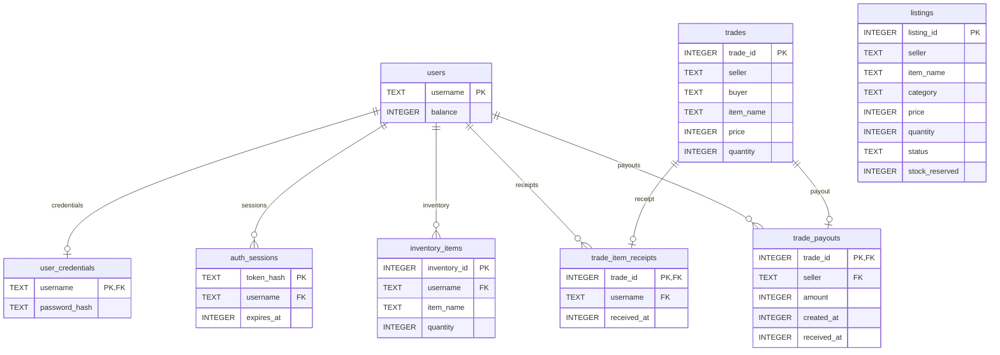

# Auction World

FastAPI와 SQLite로 구현한 게임 아이템 거래소 개인 프로젝트입니다.

회원가입부터 아이템 판매 등록, 구매, 물품 수령, 판매 취소까지의 거래 흐름을 구현했습니다.
거래 과정에서 재화와 아이템 수량이 올바르게 유지되는지 자동 테스트로 검증합니다.

실제 게임 계정이나 재화와 연결되지 않는 가상 거래 서비스입니다.

## 주요 기능

### 계정과 인증

- 회원가입과 Argon2 기반 비밀번호 해시 저장
- Bearer 토큰을 사용하는 로그인
- 로그인 토큰의 해시와 만료 시각을 DB에 저장
- 토큰 유효 시간 1시간
- 로그아웃한 토큰과 만료된 토큰의 접근 차단
- 본인 잔액과 본인이 참여한 거래만 조회하도록 권한 검사

### 아이템 검색

- 아이템 이름, 분류, 가격 범위로 검색
- 최신 등록순, 낮은 가격순, 높은 가격순 정렬
- 페이지 단위 조회
- 기본 페이지 크기 20개, 최대 100개
- 판매 중인 상품만 검색 결과에 표시

### 판매와 구매

- 보관함에서 보유한 아이템을 선택해 판매 등록
- 판매 등록 수량만큼 보관함에서 차감
- 상품 일부 수량 구매
- 구매 시 구매자 재화 차감 및 미수령 판매 대금기록
- 완료 탭에서 판매 대금 수령 및 중복 지급 방지
- 판매 수량 감소 및 거래 기록 저장
- 본인 상품 구매와 보유 재화를 초과한 구매 차단

### 거래 완료와 보관함

- 로그인한 계정의 구매·판매 내역 조회
- 구매한 물품을 수령하면 보관함에 추가
- 동일 거래의 중복 수령 방지
- 본인이 등록한 상품의 판매 취소
- 판매 취소 시 아직 팔리지 않은 수량을 보관함에 반환

## 사용 기술

| 영역 | 기술 |
|---|---|
| 언어 | Python 3.13 |
| API | FastAPI, Pydantic |
| 서버 실행 | Uvicorn |
| 데이터 저장 | SQLite |
| 화면 | HTML, CSS, JavaScript |
| 비밀번호 저장 | pwdlib, Argon2 |
| 인증 | Bearer 토큰, DB 기반 로그인 세션 |
| 테스트 | pytest, FastAPI TestClient |

라이브러리 버전은 `requirements.txt`에서 관리합니다.

## 설치 및 실행

### 실행 환경

- Windows
- Python 3.13
- PowerShell

아래 명령은 프로젝트 폴더에서 실행합니다.

### 1. 가상환경 생성

```powershell
py -3.13 -m venv .venv
```

### 2. 라이브러리 설치

```powershell
.\.venv\Scripts\python.exe -m pip install -r requirements.txt
```

가상환경을 활성화하지 않아도 위와 같이 실행 파일 경로를 지정해 사용할 수 있습니다.

### 3. 데모 계정 생성

```powershell
.\.venv\Scripts\python.exe seed_demo.py
```

안내에 따라 12~128자의 비밀번호를 입력합니다.
입력 중 글자나 별표가 표시되지 않는 것이 정상입니다.

새로 생성하는 두 데모 계정은 입력한 비밀번호를 함께 사용합니다.

| 계정 | 초기 재화 | 초기 아이템 |
|---|---:|---|
| `demo_seller` | 0 | 모험가의 검 5개, 회복 물약 20개 |
| `demo_buyer` | 1,000,000 | 없음 |

이미 존재하는 계정은 건너뜁니다.
스크립트를 다시 실행해도 기존 계정의 잔액·비밀번호·아이템을 덮어쓰거나 추가 지급하지 않습니다.

데모 계정은 로컬 시연용입니다.

### 4. 서버 실행

```powershell
.\.venv\Scripts\python.exe -m uvicorn main:app --reload
```

- [거래소 화면](http://127.0.0.1:8000/market)
- [API 문서](http://127.0.0.1:8000/docs)
- [서버 상태 확인](http://127.0.0.1:8000/health)

서버 종료는 실행 중인 터미널에서 `Ctrl+C`를 누릅니다.

`--reload`는 개발 중 코드 변경을 반영하기 위한 옵션입니다.

핵심 거래 기능 실행에는 이메일·문자 발송 설정이 필요하지 않습니다.

## 데모 시연 순서

아래 예상 결과는 데모 계정을 처음 생성한 상태를 기준으로 합니다.
이미 사용한 계정은 현재 잔액과 보유 수량이 다를 수 있습니다.

1. `demo_seller`로 로그인합니다.
2. 보관함에서 모험가의 검을 선택합니다.
3. 분류는 무기, 개당 가격은 1,000, 수량은 2개로 판매 등록합니다.
4. 로그아웃하고 `demo_buyer`로 로그인합니다.
5. 검색 결과에서 해당 상품을 더블클릭해 구매 팝업을 엽니다.
6. 수량 1개와 총액 1,000을 확인하고 구매합니다.
7. 완료 탭의 구매 내역에서 물품을 수령합니다.
8. 구매자의 보관함에 검 1개, 잔액에 999,000이 표시되는지 확인합니다.
9. 판매자로 다시 로그인합니다.
10. 대금 수령 전에는 판매자 잔액이 0인지 확인합니다.
11. 완료 탭의 판매 내역에서 대금 수령을 누릅니다.
12. 판매자 잔액이 1,000으로 증가하고 대금 수령 완료로 표시되는지 확인합니다.
13. 판매 탭에서 남은 검 1개의 판매를 취소합니다.
14. 판매자의 보관함에 검 4개가 표시되는지 확인합니다.

최종적으로 두 계정이 가진 검의 합계는 5개,
대금 수령 후 재화의 합계는 1,000,000으로 유지됩니다.

## 거래 데이터 처리

### 판매 등록

로그인한 사용자의 보유 아이템과 수량을 확인합니다.
하나의 트랜잭션에서 보관함 수량 차감과 판매 등록 생성을 처리합니다.

판매자는 요청에서 임의로 지정하지 않고 로그인한 계정을 사용합니다.

### 구매

하나의 트랜잭션 안에서 다음 작업을 처리합니다.

1. 판매 상태와 남은 수량 확인
2. 본인 상품 구매 여부와 구매자 잔액 확인
3. 구매자 재화 차감
4. 판매 수량과 상태 변경
5. 거래 기록 생성
6. 해당 거래의 미수령 판매 대금 기록

판매자에게 즉시 입금하지 않고 'trade_payouts'에 대금을 기록합니다.

쓰기 트랜잭션은 `BEGIN IMMEDIATE`로 시작합니다.
작업 중 오류가 발생하면 해당 트랜잭션의 변경을 취소합니다.

### 판매 대금 수령

판매자는 완료 탭의 판매 내역에서 거래별 대금을 수령합니다.

- 거래의 판매자 본인인지 확인합니다.
- 미수령 대금이 존재하는지 확인합니다.
- 판매자의 최신 잔액을 기준으로 보유 한도를 검사합니다.
- 잔액 증가와 수령 시각 기록을 하나의 트랜잭션으로 처리합니다.
- 이미 수령한 대금의 중복 지급을 차단합니다.

새 정산 방식 도입 전 자동 입금된 거래는 별도 수량 대상으로 만들지 않습니다.

거래 내역에는 다음 상태를 반환합니다.

| 상태 | 의미 |
|---|---|
| `pending` | 대금 수령 가능 |
| `received` | 대금 수령 완료 |
| `legacy` | 기존 자동 입금 거래 |

수령 전에는 사용자 잔액과 미수령 대금을 합산해야 전체 재화를 확인할 수 있습니다.


### 물품 수령

거래의 구매자 본인인지 확인합니다.
보관함에 아이템을 추가하고 수령 기록을 생성하는 작업을 하나의 트랜잭션으로 처리합니다.

수령 기록의 `trade_id`를 기본키로 사용해 동일 거래의 중복 수령을 방지합니다.

### 판매 취소

판매 등록의 소유자만 취소할 수 있습니다.

보관함에서 차감해 등록한 상품은 아직 팔리지 않은 수량만 반환합니다.
이전 방식으로 등록한 상품은 `stock_reserved` 값으로 구분해 잘못된 아이템 반환을 방지합니다.

### 동시 구매

두 구매자가 마지막 상품 1개를 동시에 구매하는 상황을 테스트했습니다.

- 구매 성공 1건
- 재고 부족에 따른 거절 1건
- 성공한 구매자의 재화만 차감
- 판매자 대금 1회 입금
- 거래 기록 1건 생성

이 테스트는 두 요청의 경쟁 상황을 검증합니다.
대규모 트래픽 처리 성능을 보장하는 부하 테스트는 아닙니다.

## 인증과 조회 권한

- 비밀번호 원문 대신 Argon2 해시를 저장합니다.
- 로그인 토큰 원문 대신 SHA-256 해시를 DB에 저장합니다.
- 인증이 필요한 요청마다 토큰과 만료 시각을 검사합니다.
- 로그아웃 시 해당 토큰의 세션을 삭제합니다.
- 사용자 잔액은 본인만 조회할 수 있습니다.
- 거래 목록과 거래 통계는 본인이 참여한 거래로 제한합니다.
- 거래 상세는 해당 거래의 판매자와 구매자만 조회할 수 있습니다.
- 판매 통계는 본인의 판매 실적만 반환합니다.

로그인하지 않았거나 토큰이 유효하지 않으면 `401`을 반환합니다.
다른 사용자의 잔액 조회는 `403`으로 거절합니다.

거래 상세는 조회 권한이 없거나 거래가 존재하지 않을 때 모두 `404`를 반환해
다른 사람의 거래 존재 여부를 응답으로 구분하지 않도록 했습니다.

## 주요 API

인증이 필요한 API는 다음 헤더를 사용합니다.

```text
Authorization: Bearer <access_token>
```

### 계정

| 메서드 | 경로 | 기능 | 인증 |
|---|---|---|---|
| POST | `/auth/signup` | 회원가입 | 불필요 |
| POST | `/auth/login` | 로그인 및 토큰 발급 | 불필요 |
| POST | `/auth/logout` | 요청한 토큰의 세션 삭제 | 필요 |
| GET | `/auth/me` | 로그인한 사용자 정보와 잔액 조회 | 필요 |
| GET | `/users/{username}` | 지정한 아이디가 본인인 경우 잔액 조회 | 필요 |

### 검색과 거래

| 메서드 | 경로 | 기능 | 인증 |
|---|---|---|---|
| GET | `/listings` | 판매 중인 상품 검색·정렬·페이지 조회 | 불필요 |
| POST | `/listings` | 보유 아이템 판매 등록 | 필요 |
| GET | `/me/listings` | 내 판매 등록 내역 조회 | 필요 |
| POST | `/listings/{listing_id}/purchase` | 상품 구매 | 필요 |
| POST | `/listings/{listing_id}/cancel` | 내 판매 등록 취소 | 필요 |
| GET | `/me/trades` | 내 구매·판매 내역 조회 | 필요 |
| GET | `/trades` | 본인이 참여한 거래 목록 조회 | 필요 |
| GET | `/trades/{trade_id}` | 본인이 참여한 거래 상세 조회 | 필요 |
| POST | `/trades/{trade_id}/receive` | 구매 물품 수령 | 필요 |
| POST | `/trades/{trade_id}/payout` | 본인의 미수령 판매 대금 수령 | 필요 |
| GET | `/me/inventory` | 내 보관함 조회 | 필요 |

### 통계

| 메서드 | 경로 | 기능 | 인증 |
|---|---|---|---|
| GET | `/trade-stats` | 본인이 참여한 거래의 건수·수량·금액 합계 | 필요 |
| GET | `/seller-stats` | 본인의 판매 건수·수량·금액 합계 | 필요 |

`/trade-stats`의 금액은 구매·판매 거래 금액의 합계이며 현재 잔액이나 순이익이 아닙니다.

`/seller-stats`의 거래 건수 필드는 기존 응답과의 호환을 위해 `tade_count`라는 이름을 유지합니다.

### 검색 요청 예시

```text
GET /listings?category=무기&sort_by=price_low&page=1&page_size=20
```

| 파라미터 | 의미 |
|---|---|
| `keyword` | 아이템 이름에 포함된 문자열 |
| `category` | 무기, 방어구, 소비, 기타 |
| `min_price` | 최저 개당 가격 |
| `max_price` | 최고 개당 가격 |
| `sort_by` | latest, price_low, price_high |
| `page` | 1부터 시작하는 페이지 번호 |
| `page_size` | 페이지당 상품 수, 기본 20·최대 100 |

응답의 `total`은 현재 페이지의 상품 수가 아니라 검색 조건에 맞는 전체 상품 수입니다.
`listings`에는 요청한 페이지의 상품만 포함됩니다.

### 구매 요청 예시

```text
POST /listings/{listing_id}/purchase
```

```json
{
  "quantity": 2
}
```

## 자동 테스트

서버를 별도로 실행하지 않아도 테스트할 수 있습니다.

```powershell
.\.venv\Scripts\python.exe -m pytest -v
```

테스트마다 임시 SQLite DB를 사용하며 실제 `game_data.db`는 변경하지 않습니다.

| 테스트 파일 | 검증 내용 |
|---|---|
| `test_purchase.py` | 거래 흐름, 잘못된 구매 거절, 재화·아이템 수량 보존, 판매 대금 수령·중복 지급 방지·정산 상태 검증 |
| `test_concurrency.py` | 마지막 상품의 동시 구매 시 한 명만 구매 성공 |
| `test_permissions.py` | 로그인 검사, 타인 잔액·거래 접근 차단, 목록·통계의 조회 범위 |
| `test_pagination.py` | 페이지별 개수, 상품 중복 여부, 정렬·검색 조건 유지, 입력 범위 |
| `test_auth.py` | 잘못된 비밀번호, 로그아웃한 토큰, 다른 세션 유지, 만료·가짜 토큰 차단 |

### 검증 결과

2026-11-24 기준 전체 테스트 결과:

```text
5 passed, 1 warning
```

별도의 가상환경에서도 `requirements.txt`로 라이브러리를 설치한 뒤
전체 테스트 5개가 통과하는 것을 확인했습니다.

경고는 TestClient의 `httpx` 사용에 관한 사용 중단 예정 안내이며,
현재 테스트 실패는 아닙니다.

## DB 구조

핵심 거래 기능에서 사용하는 테이블과 실제 외래키 관계입니다.
일부 시각·기본값 등 세부 컬럼 설명은 생략했습니다.



### 주요 제약

- 보관함의 `(username, item_name)` 조합은 중복될 수 없습니다.
- 수령 기록의 `trade_id`가 기본키이므로 거래당 수령 기록은 최대 한 건입니다.
- 잔액은 음수가 될 수 없습니다.
- 판매 수량은 0 이상, 보관함 수량은 1 이상이어야 합니다.
- 판매 상태는 판매중·판매완료·취소로 제한합니다.

### 현재 관계 설계의 한계

- `listings.seller`, `trades.seller`, `trades.buyer`는 문자열로 저장하며 사용자 테이블에 대한 외래키가 없습니다.
- 거래 기록에는 판매 등록 번호가 없어 판매 등록과 거래 사이의 직접적인 외래키가 없습니다.
- 사용자와 거래 참여자에 대한 확인은 API에서 수행합니다.
- 미완성 이메일 인증용 테이블은 위 핵심 구조도에서 제외했습니다.

## 주요 파일

| 파일 | 역할 |
|---|---|
| `main.py` | 인증·검색·판매·구매·수령·통계 API |
| `database.py` | DB 연결, 테이블 생성 및 스키마 변경 |
| `market.html` | 거래소 화면과 API 호출 |
| `seed_demo.py` | 데모 계정과 초기 데이터 생성 |
| `test_purchase.py` | 거래 흐름과 실패 상황 검증 |
| `test_concurrency.py` | 마지막 상품의 동시 구매 검증 |
| `test_permissions.py` | 조회 권한 검증 |
| `test_pagination.py` | 검색 페이지 기능 검증 |
| `test_auth.py` | 로그인 세션과 토큰 검증 |
| `requirements.txt` | 라이브러리 버전 목록 |
| `.gitignore` | 비밀 설정·DB·가상환경 등의 Git 제외 규칙 |

## 데이터와 설정 관리

- `game_data.db`는 DB 초기화 시 생성하며 Git에 포함하지 않습니다.
- `.env`에는 비밀번호나 API 키가 들어갈 수 있으므로 공유하지 않습니다.
- `.venv`와 `.venv-check`는 Git에 포함하지 않습니다.
- 다른 PC에서는 가상환경을 새로 생성하고 라이브러리를 설치합니다.
- 개인 DB를 전달하는 대신 `seed_demo.py`로 시연 데이터를 준비합니다.
- 데모 스크립트는 기존 계정의 데이터를 초기화하지 않습니다.

## 현재 한계와 향후 개선

- 같은 이름의 아이템은 보관함에서 수량을 합산합니다.
- 개별 장비 옵션과 아이템 고유 식별자를 지원하지 않습니다.
- 아이템 분류는 판매 등록 시 직접 선택합니다.
- 판매 대금은 거래별로 수령하며 수수료와 일괄 수령은 지원하지 않습니다.
- 거래 내역과 보관함에는 검색 상품 목록과 같은 페이지 기능이 없습니다.
- 이메일·문자 인증, 계정 찾기, 비밀번호 재설정은 미완성입니다.
- 화면 조작에 대한 브라우저 자동 테스트는 포함하지 않습니다.
- 검증은 로컬 개발 환경과 임시 SQLite DB를 기준으로 수행했습니다.
- 공개 배포와 대규모 트래픽에 대한 성능·운영 검증은 수행하지 않았습니다.

향후에는 데이터 관계 보완, 조회 성능 측정, 배포 환경 구성과
운영 중 오류를 확인할 수 있는 로그·모니터링 체계 개선을 검토할 계획입니다.